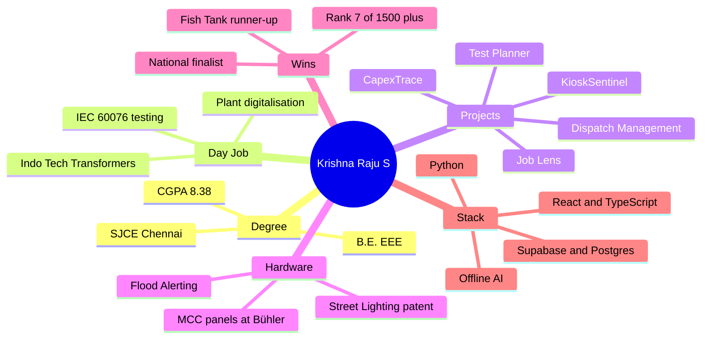
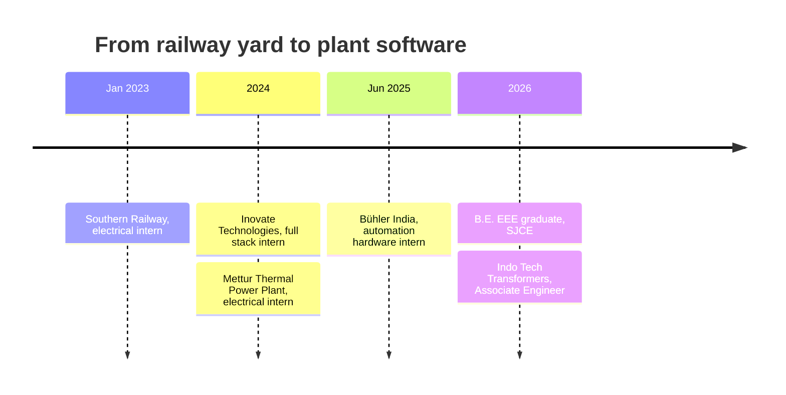
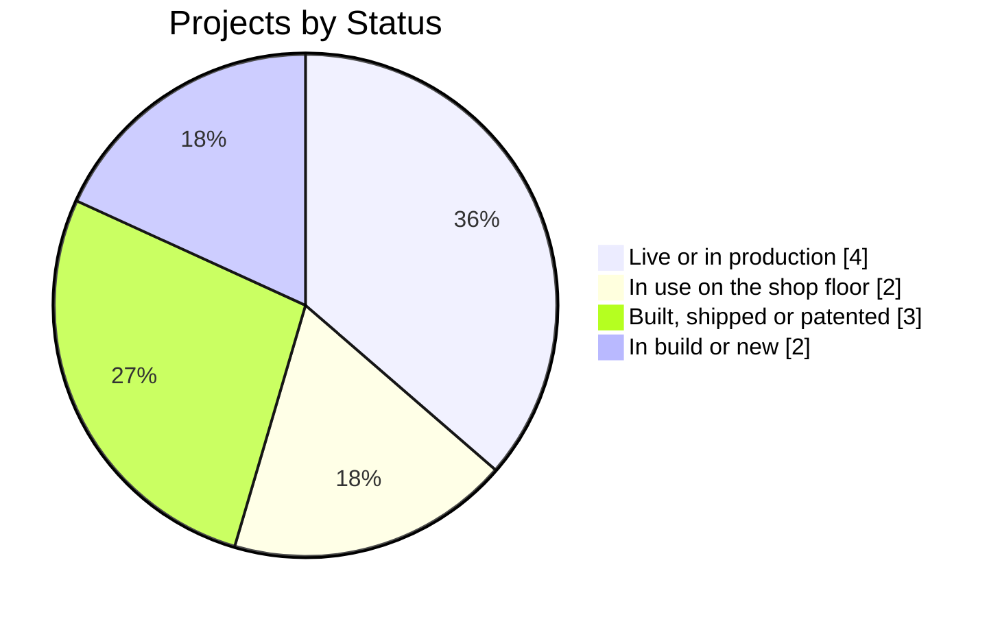
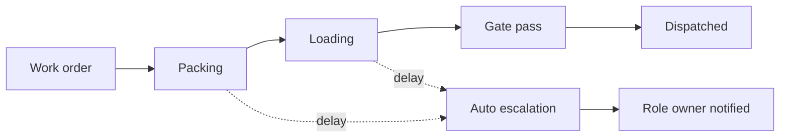
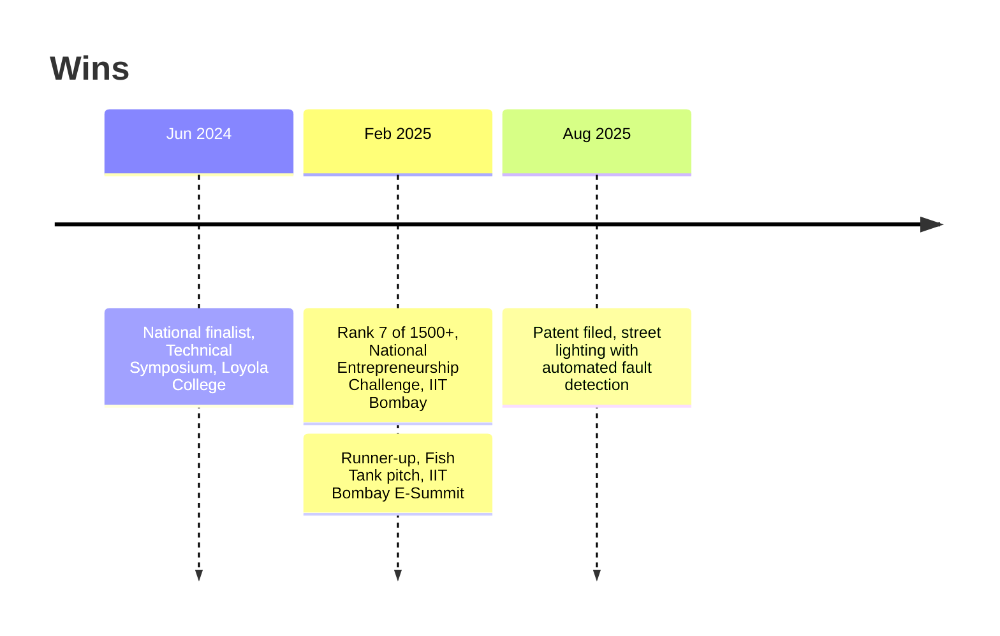

  

 

  

  

---

## 👋 About Me

Hello, I am **Krishna Raju S**, an Electrical & Electronics Engineer from Chennai, India.

I graduated **B.E. EEE from St. Joseph's College of Engineering (2026, CGPA 8.38)** and joined **Indo Tech Transformers** as an Associate Engineer. I started in IEC 60076 transformer testing (SFRA, PD, OLTC) and now write the plant's software.

My work in one line:

> **Engineering isn't just circuits and code. It's building things that make a real difference.**

I test 161 kV transformers by day and build shop-floor software by night: dispatch, test planning, capex tracking and offline AI tools that run where the internet doesn't.

**Languages I speak:** Tamil · English · Kannada · Hindi

### 🔗 Find Me Online

| Where | Link |
|:--|:--|
| 🌐 Portfolio | [krish-exe.vercel.app](https://krish-exe.vercel.app/) |
| 💼 LinkedIn | [linkedin.com/in/krishnarajus2004](https://linkedin.com/in/krishnarajus2004) |
| 🧑‍💻 GitHub | [github.com/KRISH-exe-29](https://github.com/KRISH-exe-29) |
| 📧 Email | krishnarajus2004@gmail.com |

### 📑 Contents

[Big Picture](#️-the-big-picture) · [Experience](#-experience) · [Projects](#-the-11-projects) · [Flagship](#-flagship-dispatch-management) · [Wins](#-wins-and-recognition) · [Certifications](#-certifications) · [Skills](#-skills-and-tools) · [Activity](#-github-activity) · [Rules](#-my-working-rules) · [Connect](#-connect--collaborate)

---

## 🗺️ The Big Picture

### 📅 Career Timeline

---

## 💼 Experience

| Where | Role | When | What I did | Win |
|:--|:--|:-:|:--|:--|
| **Indo Tech Transformers**, Kanchipuram | Associate Engineer, Testing & Projects → Digitalisation | 2026 to now | Started in IEC 60076 testing (SFRA, PD, OLTC). Now writes the plant's software | Fastener standard pitched to the CEO, approved |
| **Bühler India**, Bengaluru | Automation Hardware Engineering Intern | Jun 2025 | MCC panels for 8 to 10 TPH plants: DOL, VFD, soft-starter feeders, I/O cards | Python tool: 30 min of paperwork → 30 s |
| **Inovate Technologies**, Chennai | Full Stack Developer Intern | Mar to Jun 2024 | Shipped Project Phantom end to end in HTML, CSS and JavaScript | First production deploy |
| **Mettur Thermal Power Plant**, Tamil Nadu | Electrical Intern | Jun to Jul 2024 | Inspected generation-side electrical systems and wrote the reports | Saw megawatts up close |
| **Southern Railway**, Chennai | Electrical Intern | Jan 2023 | Electrical documentation and quality inspection | Where it started |

---

# 💻 THE 11 PROJECTS

I would rather ship a few tools people use every day than publish many half-done repositories.

| # | Project | Status | What it does | Impact | Stack |
|:-:|:--|:--|:--|:--|:--|
| 1 | **[Dispatch Management](https://github.com/KRISH-exe-29/Dispatch-ITTL)** ⭐ |  | Work order → packing → loading → gate pass | 5 roles · 128 tests · auto escalations | React 19 · Supabase · PL/pgSQL |
| 2 | **[Job Lens](https://krishna-ittl.github.io/Candidate-Screener/)** |  | 100 resumes in, a ranked shortlist out | Offline AI · OCR · Excel reports | TypeScript · Transformers.js |
| 3 | **[Test Planner](https://transformer-test-planner.vercel.app)** |  | Every IEC 60076 test, scheduled | 40 tests · multi-unit · Excel export | TypeScript · Next.js |
| 4 | **[Industrial Data System](https://github.com/KRISH-exe-29/indotech-transformers)** |  | QR-tagged test data + a 3D transformer | 4 role modules · OTP admin | React · Three.js |
| 5 | **[Hardware Platform v1.3](https://github.com/KRISH-exe-29/Fasteners-Project)** |  | Hardware PDF in, weighted BOM out | 20 to 30 min → under 60 s | Python · PyQt5 · Pandas |
| 6 | **[RTCC & M.Box Tracker](https://github.com/KRISH-exe-29/Pannel-Box-Transformers-)** |  | Chases pending points so nobody has to | 48-hour auto follow-ups | React · Express · node-cron |
| 7 | **Intelligent Street Lighting** |  | A light bubble that follows the car | 60% less energy · GPS fault alerts | C · ESP8266 · MERN |
| 8 | **HWE Automation Tool** |  | Feeder classes, loads and I/O in one click | 30 min → 30 s at Bühler | Python · Streamlit |
| 9 | **Flood Alerting System** |  | Rising water, instant alerts | 90% lower outage risk | IoT · Embedded C |
| 10 | **KioskSentinel** |  | Attendance that survives power cuts | Offline-first · 3 shifts · locked down | Java 21 · SQLite · Postgres |
| 11 | **CapexTrace** |  | Every capex rupee, traced box by box | WBS mind map · budget ceilings | TypeScript · React 19 · React Flow |

*Projects without a link are private or internal to the plant.*

### ⭐ Flagship: Dispatch Management

The plant's dispatch flow, from the order to the gate.

**Built with:** 5 user roles, Supabase with PL/pgSQL workflows, and 128 tests.

<b>Details: shop-floor tools</b>

**Job Lens:** Resume screening that runs in the browser. OCR reads scanned resumes, an offline model ranks them, and the shortlist exports to Excel.

**Test Planner:** Schedules all 40 IEC 60076 transformer tests across multiple units and exports the plan to Excel.

**Industrial Data System:** QR codes tag test records. Four role-based modules, OTP-protected admin and a 3D transformer built in Three.js.

**Hardware Platform v1.3:** Reads a hardware PDF and produces a weighted bill of materials. A 20 to 30 minute task now takes under a minute.

**RTCC & M.Box Tracker:** Tracks pending points and sends follow-ups every 48 hours until they close.

**CapexTrace:** Capex budgets as a work-breakdown tree, so no line can outspend the one above it.

**KioskSentinel:** Offline-first attendance kiosk for 3 shifts that keeps working through power cuts.

<b>Details: hardware and IoT</b>

**Intelligent Street Lighting (patent filed, Aug 2025):** Street lights that brighten around a moving vehicle and report their own faults with GPS location. About 60% less energy.

**Flood Alerting System:** Water-level sensing with instant alerts, cutting outage risk by about 90%.

**HWE Automation Tool (Bühler):** Picks feeder classes, loads and I/O in one click for MCC panel design.

---

# 🏆 WINS AND RECOGNITION

| When | Win | Where |
|:-:|:--|:--|
| Feb 2025 | 🥇 **Rank #7 / 1500+** | National Entrepreneurship Challenge, IIT Bombay |
| Feb 2025 | 🥈 **Runner-up** | Fish Tank pitch, IIT Bombay E-Summit |
| Aug 2025 | 📜 **Patent filed** | Street lighting with automated fault detection |
| Jun 2024 | 🏅 **National finalist** | Technical Symposium, Loyola College |

---

# 🏅 CERTIFICATIONS

| Certificate | Provider |
|:--|:--|
| Arduino & C | UC Irvine |
| Raspberry Pi & Python | UC Irvine |
| Introduction to IoT | NPTEL |
| Digital Circuits | NPTEL |
| Supply Chain Management | CII |

---

# 🧮 SKILLS AND TOOLS

| Area | Topics |
|:--|:--|
| ⚡ Power | IEC 60076 testing, SFRA, OLTC, MCC panels, VFD · DOL · soft starter, relays 87T · 63 · 64REF, AutoCAD, MATLAB |
| 💻 Code | TypeScript, React, Python, Java, C, Node, Supabase, PostgreSQL, Three.js |
| 🔌 Things | ESP8266, Arduino, Raspberry Pi, Proteus, IoT |
| 🤖 AI | Claude, OpenAI, LangChain, LangGraph, Transformers.js |

---

# 📈 GITHUB ACTIVITY

---

## 📜 My Working Rules

1. **Solve the shop floor's problem.** If nobody on the floor uses it, it isn't done.
2. **Minutes to seconds.** Automate the paperwork so engineers can engineer.
3. **Offline first.** Plants lose power and internet. The software should not care.
4. **Ship, then polish.** A working tool today beats a perfect one next quarter.
5. **Test everything.** Real users, real data, real tests.

---

## 🤝 Connect & Collaborate

I am happy to talk about **power systems, shop-floor software, and AI that runs offline**. If you are digitalising a plant or building tools for engineers, let's connect!

### 📬 Direct Channels

| Platform | Link / Handle | Action |
| :--- | :--- | :--- |
| 📧 **Email** | [krishnarajus2004@gmail.com](mailto:krishnarajus2004@gmail.com) | Send a direct inquiry |
| 💼 **LinkedIn** | [Krishna Raju S](https://linkedin.com/in/krishnarajus2004) | Professional network & updates |
| 🌐 **Portfolio** | [krish-exe.vercel.app](https://krish-exe.vercel.app/) | Explore my projects |
| 💻 **GitHub** | [@KRISH-exe-29](https://github.com/KRISH-exe-29) | Follow for code & repositories |

---

  
  
<em>Built in Chennai, one shop-floor problem at a time. 💙</em>

