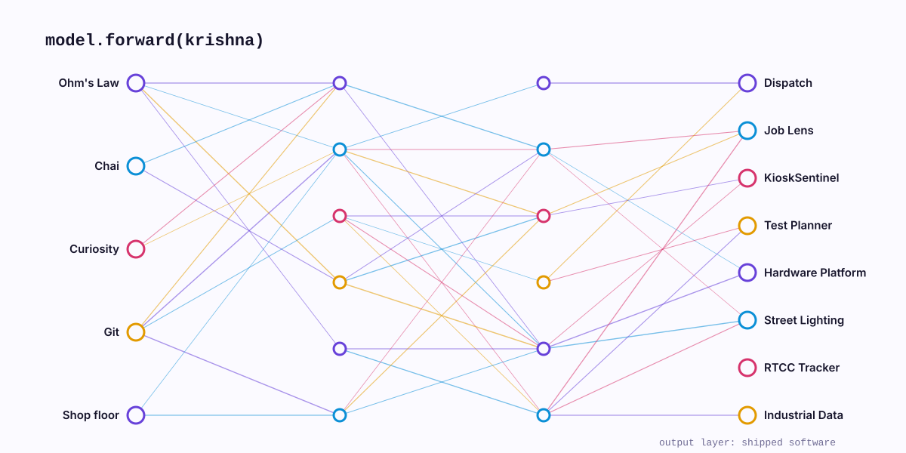

<!-- AI / generative: art seeded from the username, a firing neural net, a latent-space map and a self-typing prompt. Light and dark follow your GitHub theme. Built by scripts/gen_generative.py -->

<p align="center"><picture><source media="(prefers-color-scheme: dark)" srcset="./assets/generative/field-dark.svg"/></picture></p>
<p align="center"><picture><source media="(prefers-color-scheme: dark)" srcset="./assets/generative/network-dark.svg"/></picture></p>
<p align="center"><picture><source media="(prefers-color-scheme: dark)" srcset="./assets/generative/latent-dark.svg"/></picture></p>

```text
> sampling 10 projects at temperature 0 (deterministic, like the tests)
```

<p align="center">[Dispatch](https://github.com/KRISH-exe-29/Dispatch-ITTL) · [Job Lens](https://krishna-ittl.github.io/Candidate-Screener/) · [Test Planner](https://transformer-test-planner.vercel.app) · [Hardware Platform](https://github.com/KRISH-exe-29/Fasteners-Project) · [RTCC Tracker](https://github.com/KRISH-exe-29/Pannel-Box-Transformers-) · [Industrial Data](https://github.com/KRISH-exe-29/indotech-transformers)</p>
<p align="center"><sub>seed = sha256("KRISH-exe-29") · <a href="mailto:krishnarajus2004@gmail.com">krishnarajus2004@gmail.com</a> · <a href="https://linkedin.com/in/krishnarajus2004">linkedin</a></sub></p>

<!-- REPOS:START -->

## Latest repos

<sub>Updated automatically from GitHub by a workflow.</sub>

| Repo | What it is | Language | ★ | Last push |
|---|---|---|---|---|
| [indotech-transformers](https://github.com/KRISH-exe-29/indotech-transformers) | QR-based test data collection system for Indo Tech Transformers, with a 3D model view. React client and Node server. | JavaScript | 3 | 2026-11-10 |
| [ai-agent-skill-router](https://github.com/KRISH-exe-29/ai-agent-skill-router) | AI agent skill router + skill manager: auto-pick the right skills, subagents, plugins and MCP servers for every task in Claude Code, Codex, Cursor, Gemini CLI, Copilot and Antigravity, and audit duplicate or unused skills with safe, approved cleanup and undo. | JavaScript | 3 | 2026-11-04 |
| [capex-project-tracker](https://github.com/KRISH-exe-29/capex-project-tracker) | INDO TECH capex tracker: PR/PO budget ceiling, PO dossier, exceptions, activity log | TypeScript | 2 | 2026-10-21 |
| [BUHLER-Automation](https://github.com/KRISH-exe-29/BUHLER-Automation) | Python GUI + Excel Automation Tool for Buhler Group electrical engineering data processing. Live app: https://bulhergroupofcompany.streamlit.app/ | Python | 2 | 2026-10-13 |
| [Dmat-Practice](https://github.com/KRISH-exe-29/Dmat-Practice) | Offline exam simulator and practice app for the dMAT (Digitaler Mastertest), in a single HTML file. Unofficial study tool. | HTML | 2 | 2026-09-25 |
| [PMS](https://github.com/KRISH-exe-29/PMS) | Enterprise Project Management System for Indo Tech Transformers: projects, milestones, an interactive Gantt chart, budgets and role-based access. React 19, Vite and Supabase. | TypeScript | 1 | 2026-07-14 |

<!-- REPOS:END -->
