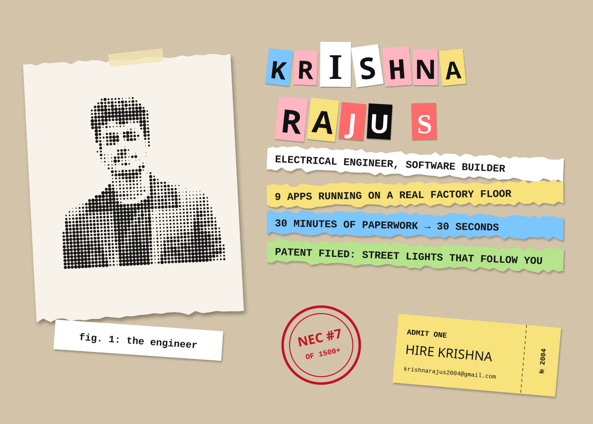
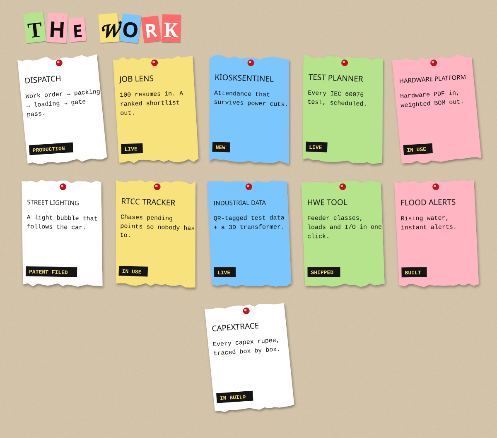

<!-- Collage / zine: cut paper on cork by day, on a dark board by night, following your GitHub theme. Built by scripts/gen_collage.py -->

<picture><source media="(prefers-color-scheme: dark)" srcset="./assets/collage/zine-dark.svg"/></picture>

<picture><source media="(prefers-color-scheme: dark)" srcset="./assets/collage/work-dark.svg"/></picture>

[Dispatch](https://github.com/KRISH-exe-29/Dispatch-ITTL) ✂ [Job Lens](https://krishna-ittl.github.io/Candidate-Screener/) ✂ [Test Planner](https://transformer-test-planner.vercel.app) ✂ [Hardware Platform](https://github.com/KRISH-exe-29/Fasteners-Project) ✂ [RTCC Tracker](https://github.com/KRISH-exe-29/Pannel-Box-Transformers-) ✂ [Industrial Data](https://github.com/KRISH-exe-29/indotech-transformers)

cut, taped and pinned in code · <a href="mailto:krishnarajus2004@gmail.com">krishnarajus2004@gmail.com</a> · <a href="https://linkedin.com/in/krishnarajus2004">linkedin</a>

<!-- REPOS:START -->

## Latest repos

Updated automatically from GitHub by a workflow.

| Repo | What it is | Language | ★ | Last push |
|---|---|---|---|---|
| [ai-courtroom-debate](https://github.com/KRISH-exe-29/ai-courtroom-debate) | ⚖️ AI courtroom: two AI lawyers debate your idea or decision, a blind AI judge scores every move and delivers a verdict. Multi-agent LLM debate with a measured judge. Works with Claude, Gemini, Ollama or your coding agent. | TypeScript | 0 | 2026-11-18 |
| [indotech-transformers](https://github.com/KRISH-exe-29/indotech-transformers) | QR-based test data collection system for Indo Tech Transformers, with a 3D model view. React client and Node server. | JavaScript | 3 | 2026-11-10 |
| [ai-agent-skill-router](https://github.com/KRISH-exe-29/ai-agent-skill-router) | AI agent skill router + skill manager: auto-pick the right skills, subagents, plugins and MCP servers for every task in Claude Code, Codex, Cursor, Gemini CLI, Copilot and Antigravity, and audit duplicate or unused skills with safe, approved cleanup and undo. | JavaScript | 3 | 2026-11-04 |
| [sop-sensei](https://github.com/KRISH-exe-29/sop-sensei) | SOP Sensei - ask the core-shop SOPs a question, get the exact answer with doc/step source and photo. Local BM25 + Ollama, English/Tamil/Hindi, anti-hallucination guardrails. | Python | 0 | 2026-10-29 |
| [capex-project-tracker](https://github.com/KRISH-exe-29/capex-project-tracker) | INDO TECH capex tracker: PR/PO budget ceiling, PO dossier, exceptions, activity log | TypeScript | 2 | 2026-10-21 |
| [BUHLER-Automation](https://github.com/KRISH-exe-29/BUHLER-Automation) | Python GUI + Excel Automation Tool for Buhler Group electrical engineering data processing. Live app: https://bulhergroupofcompany.streamlit.app/ | Python | 2 | 2026-10-13 |

<!-- REPOS:END -->

<!-- git-koi -->

My <a href="https://github.com/yalongwastaken/git-koi">git-koi</a>, redrawn every night from my GitHub activity

