<!-- Dark-mode UI as a code editor (Dark Modern), with a Light Modern twin for light mode. Built by scripts/gen_ide.py -->

<p align="center"><picture><source media="(prefers-color-scheme: dark)" srcset="./assets/ide/editor-dark.svg"/></picture></p>

```bash
$ git clone https://github.com/KRISH-exe-29 && cd krishna
$ npm run hire   # → krishnarajus2004@gmail.com
```

**Open a project:** [`dispatch`](https://github.com/KRISH-exe-29/Dispatch-ITTL) · [`job-lens`](https://krishna-ittl.github.io/Candidate-Screener/) · [`test-planner`](https://transformer-test-planner.vercel.app) · [`hardware`](https://github.com/KRISH-exe-29/Fasteners-Project) · [`rtcc`](https://github.com/KRISH-exe-29/Pannel-Box-Transformers-) · [`industrial-data`](https://github.com/KRISH-exe-29/indotech-transformers)

<!-- REPOS:START -->

## Latest repos

<sub>Updated automatically from GitHub by a workflow.</sub>

| Repo | What it is | Language | ★ | Last push |
|---|---|---|---|---|
| [Dispatch-ITTL](https://github.com/KRISH-exe-29/Dispatch-ITTL) | Dispatch management system for Indo Tech Transformers: work orders, packing and loading lists, and vehicle gate tracking with five user roles. React 19, Vite and Supabase. | JavaScript | 2 | 2026-11-23 |
| [PMS](https://github.com/KRISH-exe-29/PMS) | Enterprise Project Management System for Indo Tech Transformers: projects, milestones, an interactive Gantt chart, budgets and role-based access. React 19, Vite and Supabase. | TypeScript | 1 | 2026-11-23 |
| [Pannel-Box-Transformers-](https://github.com/KRISH-exe-29/Pannel-Box-Transformers-) | RTCC panel and marshaling box tracker for Indo Tech Transformers: inspection stages, pending points and automatic follow-up emails. React, Express and Supabase. | JavaScript | 2 | 2026-11-23 |
| [sop-sensei](https://github.com/KRISH-exe-29/sop-sensei) | SOP Sensei - ask the core-shop SOPs a question, get the exact answer with doc/step source and photo. Local BM25 + Ollama, English/Tamil/Hindi, anti-hallucination guardrails. | Python | 0 | 2026-11-23 |
| [capex-project-tracker](https://github.com/KRISH-exe-29/capex-project-tracker) | INDO TECH capex tracker: PR/PO budget ceiling, PO dossier, exceptions, activity log | TypeScript | 2 | 2026-11-23 |
| [BUHLER-Automation](https://github.com/KRISH-exe-29/BUHLER-Automation) | Python GUI + Excel Automation Tool for Buhler Group electrical engineering data processing. Live app: https://bulhergroupofcompany.streamlit.app/ | Python | 2 | 2026-11-23 |

<!-- REPOS:END -->

<sub>⑂ main · ✓ 0 problems · [linkedin](https://linkedin.com/in/krishnarajus2004) · [email](mailto:krishnarajus2004@gmail.com)</sub>

<!-- git-koi -->
<div align="center">


<sub>My <a href="https://github.com/yalongwastaken/git-koi">git-koi</a>, redrawn every night from my GitHub activity</sub>

</div>

<!-- showreel: added by the daily-design workflow from reel/section.md -->
## 🎬 Showreel

<p align="center"><a href="./reel/portfolio-reel.mp4"></a></p>

<p align="center"><sub>30 seconds, made in code with <a href="https://www.remotion.dev">Remotion</a>. <a href="./reel/portfolio-reel.mp4">Watch the full-quality MP4</a>.</sub></p>
