<!-- Experimental: the profile as a git commit graph. Light and dark follow your GitHub theme. Built by scripts/gen_gitgraph.py -->

<p align="center"><picture><source media="(prefers-color-scheme: dark)" srcset="./assets/gitgraph/graph-dark.svg"/></picture></p>

```console
$ git branch --list 'feature/*'
  * feature/dispatch           Work order → packing → loading → gate pass.
  * feature/job-lens           100 resumes in. A ranked shortlist out.
    feature/kiosk-sentinel     Attendance that survives power cuts.
  * feature/test-planner       Every IEC 60076 test, scheduled.
    feature/hardware           Hardware PDF in, weighted BOM out.
    feature/street-light       A light bubble that follows the car.
    feature/rtcc               Chases pending points so nobody has to.
  * feature/industrial-data    QR-tagged test data + a 3D transformer.
    feature/hwe-tool           Feeder classes, loads and I/O in one click.
    feature/flood              Rising water, instant alerts.
    feature/capextrace         Every capex rupee, traced box by box.
```

```console
$ git log --oneline --decorate
* HEAD000 (tag: hire-me) HEAD → main · next: your project?
* m2026it (tag: v2026) merge branch 'indotech' (9 apps in production)
| | | | | * it2026d feat(kiosk-sentinel): survive power cuts
| | | | | * it2026c feat(job-lens): rank 100 resumes offline
| | | | | * it2026b feat(dispatch): 5 roles, 128 tests, live
| | | | | * it2026a indotech: IEC 60076 testing, then software
* pt2025s (tag: v2025.08) feat: patent filed, street lights that follow the car
* m2025au merge branch 'automation'
| | | | * b2025fx perf: 30 minutes of paperwork → 30 seconds
| | | | * b2025hw automation: MCC feeder classification tool at Bühler
* n2025rk (tag: v2025.02) feat: rank #7 of 1500+ at NEC, IIT Bombay
* m2024wb merge branch 'web'
* m2024pp merge branch 'power-plant'
| | * p2024ok power-plant: big machines, small clipboards
| | | * w2024ph web: ship Project Phantom (first production deploy)
| | * p2024mt power-plant: megawatts up close at Mettur
* m2023rr merge branch 'railway'
| * 5r2023b railway: notice how much is still on paper
| * 5r2023a railway: electrical documentation + inspection
* e3e2022 feat: start B.E. Electrical & Electronics
* a1b2004 (tag: v2004) init: born in Chennai
```

```console
$ git checkout -b your-project
fatal: needs one more contributor. try: krishnarajus2004@gmail.com
```

**Checkout a feature:** [`feature/dispatch`](https://github.com/KRISH-exe-29/Dispatch-ITTL) · [`feature/job-lens`](https://krishna-ittl.github.io/Candidate-Screener/) · [`feature/test-planner`](https://transformer-test-planner.vercel.app) · [`feature/hardware`](https://github.com/KRISH-exe-29/Fasteners-Project) · [`feature/rtcc`](https://github.com/KRISH-exe-29/Pannel-Box-Transformers-) · [`feature/industrial-data`](https://github.com/KRISH-exe-29/indotech-transformers)

<!-- REPOS:START -->

## Latest repos

<sub>Updated automatically from GitHub by a workflow.</sub>

| Repo | What it is | Language | ★ | Last push |
|---|---|---|---|---|
| [ai-courtroom-debate](https://github.com/KRISH-exe-29/ai-courtroom-debate) | ⚖️ AI courtroom: two AI lawyers debate your idea or decision, a blind AI judge scores every move and delivers a verdict. Multi-agent LLM debate with a measured judge. Works with Claude, Gemini, Ollama or your coding agent. | TypeScript | 0 | 2026-11-24 |
| [ai-agent-skill-router](https://github.com/KRISH-exe-29/ai-agent-skill-router) | AI agent skill router + skill manager: auto-pick the right skills, subagents, plugins and MCP servers for every task in Claude Code, Codex, Cursor, Gemini CLI, Copilot and Antigravity, and audit duplicate or unused skills with safe, approved cleanup and undo. | JavaScript | 3 | 2026-11-23 |
| [transformer-test-planner](https://github.com/KRISH-exe-29/transformer-test-planner) | Plans the IEC 60076 tests for each power transformer unit. Built with Next.js and TypeScript, deployed on Vercel. | TypeScript | 3 | 2026-11-23 |
| [Fasteners-Project](https://github.com/KRISH-exe-29/Fasteners-Project) | Hardware automation for Indo Tech Transformers: reads a hardware PDF and generates the fastener Excel and PDF with weights. Python desktop app. | Python | 3 | 2026-11-23 |
| [PMS](https://github.com/KRISH-exe-29/PMS) | Enterprise Project Management System for Indo Tech Transformers: projects, milestones, an interactive Gantt chart, budgets and role-based access. React 19, Vite and Supabase. | TypeScript | 1 | 2026-11-23 |
| [Dispatch-ITTL](https://github.com/KRISH-exe-29/Dispatch-ITTL) | Dispatch management system for Indo Tech Transformers: work orders, packing and loading lists, and vehicle gate tracking with five user roles. React 19, Vite and Supabase. | JavaScript | 2 | 2026-11-23 |

<!-- REPOS:END -->

<sub>[linkedin](https://linkedin.com/in/krishnarajus2004) · no history was rewritten in the making of this README</sub>

<!-- git-koi -->
<div align="center">


<sub>My <a href="https://github.com/yalongwastaken/git-koi">git-koi</a>, redrawn every night from my GitHub activity</sub>

</div>
