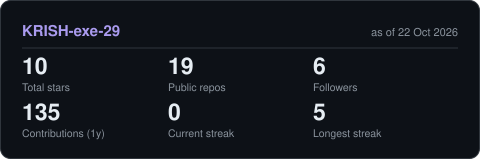

<!-- profile.sh --live. Banner, radars and stats card: python scripts/gen_live.py (facts from scripts/profile_data.py). -->
<picture>
  <source media="(prefers-color-scheme: dark)"  srcset="assets/live/banner-dark.svg">
  <source media="(prefers-color-scheme: light)" srcset="assets/live/banner-light.svg">
  
</picture>

 

 

&nbsp;&nbsp;
&nbsp;&nbsp;

 

---

## This is me :)

Hi, I'm **Krishna**, an electrical engineer from Chennai 🇮🇳.
I test 161 kV transformers by day and write the plant's software by night.

- ⚡ **Associate Engineer at Indo Tech Transformers**: started in IEC 60076 testing (SFRA, PD, OLTC), now digitalising the plant.
- 🚚 **[Dispatch Management](https://github.com/KRISH-exe-29/Dispatch-ITTL)**: work order → packing → loading → gate pass. 5 roles, 128 tests.
- 🔎 **[Job Lens](https://krishna-ittl.github.io/Candidate-Screener/)**: 100 resumes in, a ranked shortlist out. Offline AI, in the browser.
- 🧮 **CapexTrace** (in build): capex budgets as a tree, so no line can outspend the one above it.
- 🏆 **Rank #7 of 1500+** at the National Entrepreneurship Challenge, IIT Bombay. One patent filed on self-diagnosing street lighting.
- 🛠️ At Bühler I turned 30 minutes of panel paperwork into 30 seconds with a Python tool. That's the whole idea, really.
- 💬 Talk to me about **power systems, shop-floor software, or AI that runs offline**.

 

## my perfect stack

---

## signals

<table>
<tr>
<td width="50%" align="center" valign="middle">

<!-- Self-rated: edit SKILL_RADAR in scripts/gen_live.py -->
<picture>
  <source media="(prefers-color-scheme: dark)"  srcset="assets/live/radar-dark.svg">
  <source media="(prefers-color-scheme: light)" srcset="assets/live/radar-light.svg">
  
</picture>

</td>
<td width="50%" align="center" valign="middle">

<!-- Primary language of each public repo -->
<picture>
  <source media="(prefers-color-scheme: dark)"  srcset="assets/live/radar-langs-dark.svg">
  <source media="(prefers-color-scheme: light)" srcset="assets/live/radar-langs-light.svg">
  
</picture>

</td>
</tr>
</table>

---

## Numbers matter? ohhh yes.

<!-- Generated into this repo, not a shared public stats instance that can go down. -->
<picture>
  <source media="(prefers-color-scheme: dark)"  srcset="assets/live/card-stats-dark.svg">
  <source media="(prefers-color-scheme: light)" srcset="assets/live/card-stats-light.svg">
  
</picture>

---

` Built with love · Chennai `

