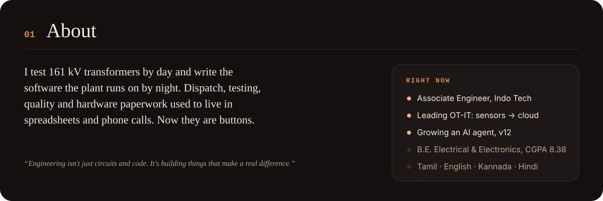
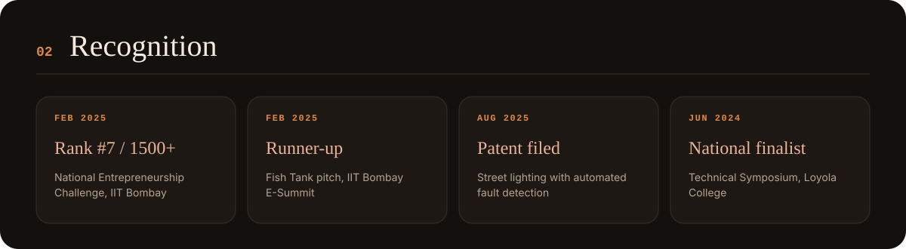
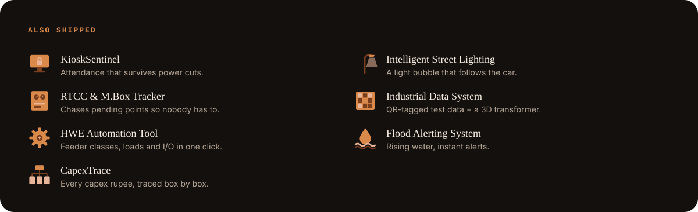
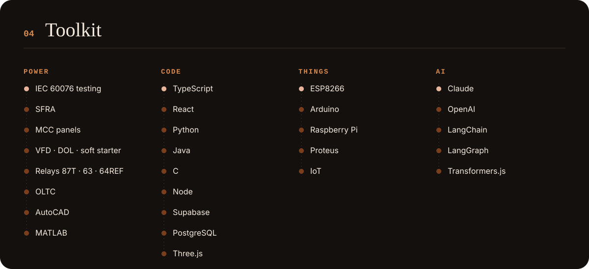
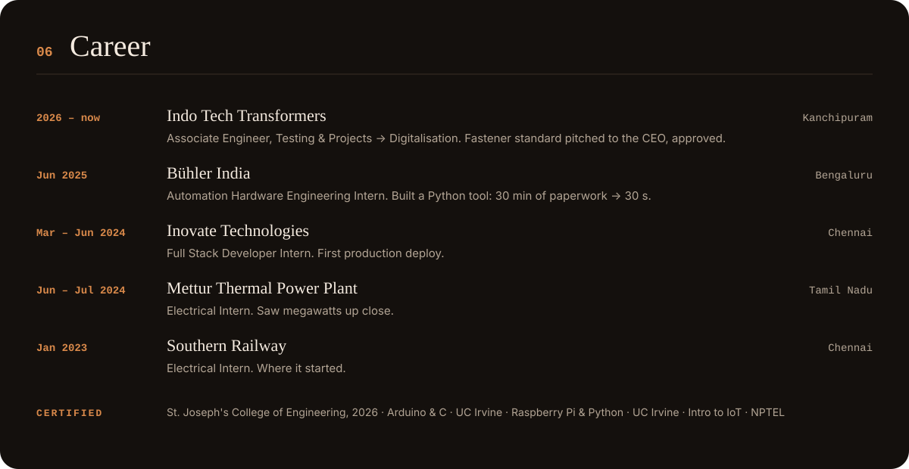

<!-- Editorial profile in numbered chapters. Built by scripts/gen_chapters.py: edit scripts/profile_data.py, then rerun. -->

  
  
  
  

<picture>
  <source media="(prefers-color-scheme: dark)" srcset="https://raw.githubusercontent.com/KRISH-exe-29/KRISH-exe-29/output/snake-dark.svg"/>
  
</picture>

  
  
  
  

