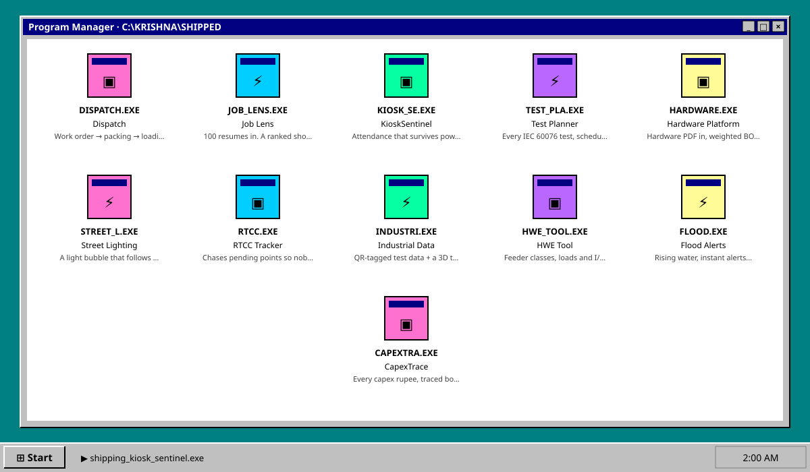

<!-- Vaporwave: Windows 95, palms, a sunset grid. Daytime pastel and midnight neon follow your GitHub theme. Built by scripts/gen_vapor.py -->

<picture><source media="(prefers-color-scheme: dark)" srcset="./assets/vapor/scene-dark.svg"/></picture>

<b>Ｗ Ｅ Ｌ Ｃ Ｏ Ｍ Ｅ　Ｔ Ｏ　Ｔ Ｈ Ｅ　Ｆ Ａ Ｃ Ｔ Ｏ Ｒ Ｙ</b> 
electrical engineer · software builder · chennai, 2004 → forever

<picture><source media="(prefers-color-scheme: dark)" srcset="./assets/vapor/desktop-dark.svg"/></picture>

[DISPATCH.EXE](https://github.com/KRISH-exe-29/Dispatch-ITTL) · [JOB LENS.EXE](https://krishna-ittl.github.io/Candidate-Screener/) · [TEST PLANNER.EXE](https://transformer-test-planner.vercel.app) · [HARDWARE PLATFORM.EXE](https://github.com/KRISH-exe-29/Fasteners-Project) · [RTCC TRACKER.EXE](https://github.com/KRISH-exe-29/Pannel-Box-Transformers-) · [INDUSTRIAL DATA.EXE](https://github.com/KRISH-exe-29/indotech-transformers)

<!-- REPOS:START -->

## Latest repos

Updated automatically from GitHub by a workflow.

| Repo | What it is | Language | ★ | Last push |
|---|---|---|---|---|
| [ai-agent-skill-router](https://github.com/KRISH-exe-29/ai-agent-skill-router) | AI agent skill router + skill manager: auto-pick the right skills, subagents, plugins and MCP servers for every task in Claude Code, Codex, Cursor, Gemini CLI, Copilot and Antigravity, and audit duplicate or unused skills with safe, approved cleanup and undo. | JavaScript | 3 | 2026-11-04 |
| [capex-project-tracker](https://github.com/KRISH-exe-29/capex-project-tracker) | INDO TECH capex tracker: PR/PO budget ceiling, PO dossier, exceptions, activity log | TypeScript | 2 | 2026-10-21 |
| [BUHLER-Automation](https://github.com/KRISH-exe-29/BUHLER-Automation) | Python GUI + Excel Automation Tool for Buhler Group electrical engineering data processing. Live app: https://bulhergroupofcompany.streamlit.app/ | Python | 2 | 2026-10-13 |
| [Dmat-Practice](https://github.com/KRISH-exe-29/Dmat-Practice) | Offline exam simulator and practice app for the dMAT (Digitaler Mastertest), in a single HTML file. Unofficial study tool. | HTML | 2 | 2026-09-25 |
| [PMS](https://github.com/KRISH-exe-29/PMS) | Enterprise Project Management System for Indo Tech Transformers: projects, milestones, an interactive Gantt chart, budgets and role-based access. React 19, Vite and Supabase. | TypeScript | 1 | 2026-07-14 |
| [Pannel-Box-Transformers-](https://github.com/KRISH-exe-29/Pannel-Box-Transformers-) | RTCC panel and marshaling box tracker for Indo Tech Transformers: inspection stages, pending points and automatic follow-up emails. React, Express and Supabase. | JavaScript | 2 | 2026-06-25 |

<!-- REPOS:END -->

<a href="mailto:krishnarajus2004@gmail.com">ｅｍａｉｌ</a> · <a href="https://linkedin.com/in/krishnarajus2004">ｌｉｎｋｅｄｉｎ</a>

