<!-- Terminal profile. Heatmap + stats: python scripts/gen_terminal.py (real data, rerun to refresh).
     Portrait: python scripts/make_ascii_svg.py (only when assets/terminal/portrait.jpg changes). -->

<h3><code>krish@github ~ $ ./contributions.sh</code></h3>

 
 

<h3><code>krish@github ~ $ whoami</code></h3>

<table>
<tr>
<td valign="top"></td>
<td valign="top"></td>
</tr>
</table>

 
 

<h3><code>krish@github ~ $ ./links.sh</code></h3>

<b>Electrical Engineer · Ships Software · Nine Apps in Production</b>

 

