<!-- Hand-drawn: an engineering notebook in light mode, a chalkboard in dark mode. Built by scripts/gen_doodle.py -->

<picture><source media="(prefers-color-scheme: dark)" srcset="./assets/doodle/notebook-dark.svg"/></picture>

<picture><source media="(prefers-color-scheme: dark)" srcset="./assets/doodle/notes-dark.svg"/></picture>

✏️ [Dispatch](https://github.com/KRISH-exe-29/Dispatch-ITTL) · [Job Lens](https://krishna-ittl.github.io/Candidate-Screener/) · [Test Planner](https://transformer-test-planner.vercel.app) · [Hardware Platform](https://github.com/KRISH-exe-29/Fasteners-Project) · [RTCC Tracker](https://github.com/KRISH-exe-29/Pannel-Box-Transformers-) · [Industrial Data](https://github.com/KRISH-exe-29/indotech-transformers)

<a href="mailto:krishnarajus2004@gmail.com">email</a> · <a href="https://linkedin.com/in/krishnarajus2004">linkedin</a> · drawn with code, not a pen

<!-- REPOS:START -->

## Latest repos

Updated automatically from GitHub by a workflow.

| Repo | What it is | Language | ★ | Last push |
|---|---|---|---|---|
| [ai-courtroom-debate](https://github.com/KRISH-exe-29/ai-courtroom-debate) | ⚖️ AI courtroom: two AI lawyers debate your idea or decision, a blind AI judge scores every move and delivers a verdict. Multi-agent LLM debate with a measured judge. Works with Claude, Gemini, Ollama or your coding agent. | TypeScript | 0 | 2026-11-24 |
| [ai-agent-skill-router](https://github.com/KRISH-exe-29/ai-agent-skill-router) | AI agent skill router + skill manager: auto-pick the right skills, subagents, plugins and MCP servers for every task in Claude Code, Codex, Cursor, Gemini CLI, Copilot and Antigravity, and audit duplicate or unused skills with safe, approved cleanup and undo. | JavaScript | 3 | 2026-11-23 |
| [transformer-test-planner](https://github.com/KRISH-exe-29/transformer-test-planner) | Plans the IEC 60076 tests for each power transformer unit. Built with Next.js and TypeScript, deployed on Vercel. | TypeScript | 3 | 2026-11-23 |
| [Fasteners-Project](https://github.com/KRISH-exe-29/Fasteners-Project) | Hardware automation for Indo Tech Transformers: reads a hardware PDF and generates the fastener Excel and PDF with weights. Python desktop app. | Python | 3 | 2026-11-23 |
| [PMS](https://github.com/KRISH-exe-29/PMS) | Enterprise Project Management System for Indo Tech Transformers: projects, milestones, an interactive Gantt chart, budgets and role-based access. React 19, Vite and Supabase. | TypeScript | 1 | 2026-11-23 |
| [Dispatch-ITTL](https://github.com/KRISH-exe-29/Dispatch-ITTL) | Dispatch management system for Indo Tech Transformers: work orders, packing and loading lists, and vehicle gate tracking with five user roles. React 19, Vite and Supabase. | JavaScript | 2 | 2026-11-23 |

<!-- REPOS:END -->

<!-- git-koi -->

My <a href="https://github.com/yalongwastaken/git-koi">git-koi</a>, redrawn every night from my GitHub activity

