<!-- Dark-mode UI as a code editor (Dark Modern), with a Light Modern twin for light mode. Built by scripts/gen_ide.py -->

<p align="center"><picture><source media="(prefers-color-scheme: dark)" srcset="./assets/ide/editor-dark.svg"/></picture></p>

```bash
$ git clone https://github.com/KRISH-exe-29 && cd krishna
$ npm run hire   # → krishnarajus2004@gmail.com
```

**Open a project:** [`dispatch`](https://github.com/KRISH-exe-29/Dispatch-ITTL) · [`job-lens`](https://krishna-ittl.github.io/Candidate-Screener/) · [`test-planner`](https://transformer-test-planner.vercel.app) · [`hardware`](https://github.com/KRISH-exe-29/Fasteners-Project) · [`rtcc`](https://github.com/KRISH-exe-29/Pannel-Box-Transformers-) · [`industrial-data`](https://github.com/KRISH-exe-29/indotech-transformers)

<sub>⑂ main · ✓ 0 problems · [linkedin](https://linkedin.com/in/krishnarajus2004) · [email](mailto:krishnarajus2004@gmail.com)</sub>

<h3 align="center">🖥️ New: two portfolio sites</h3>
<p align="center">
  <a href="https://github.com/KRISH-exe-29/KRISH_Portfolio/tree/portfolio/krish-exe"></a>
  <a href="https://github.com/KRISH-exe-29/KRISH_Portfolio/tree/portfolio/sweep"></a>
</p>
<p align="center">
  <b>Krish.exe</b>: 161,000 volts. One engineer. Zero spreadsheets.<br/>
  <b>Sweep</b>: a whole career read as one frequency sweep, 20 Hz to 2 MHz.<br/>
  <sub><a href="https://krish-exe-29.github.io/KRISH_Portfolio/">Read the portfolio</a> · twelve designs live on their own branches in <a href="https://github.com/KRISH-exe-29/KRISH_Portfolio">KRISH_Portfolio</a>.</sub>
</p>
